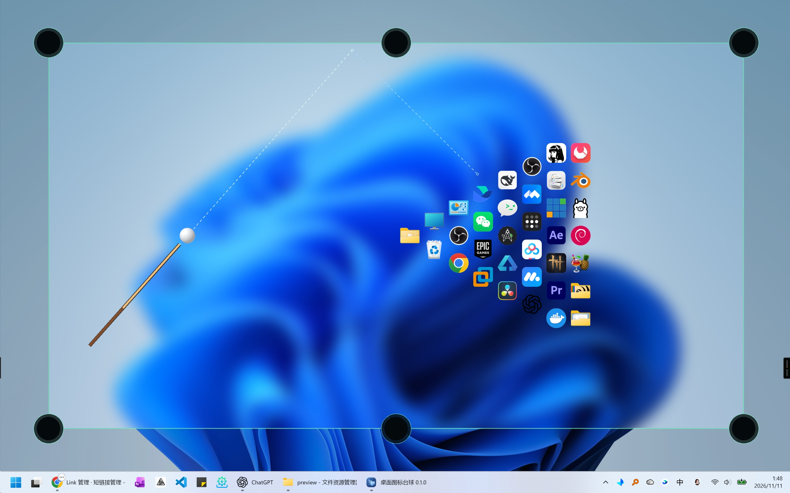
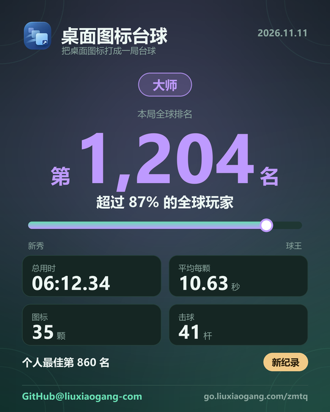
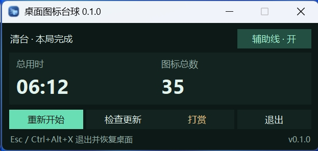

# Desktop Icon Billiards

**Turn your Windows desktop icons into a game of billiards.** Move the mouse to aim on the desktop, hold the left button to power up, release to strike. Icons keep their own thumbnails and roll, collide and sink into pockets. When you exit, the desktop is restored as it was.

Windows 10 / 11 x64 · Single-file EXE · MIT



## Download

The Windows build of v0.2.4 is a single-file EXE.

## How to Play

1. After launch, wait for the desktop icons to settle into place. Move the mouse to choose the direction of the cue ball, **hold the left button to power up, release to strike**. A “Power” progress bar appears next to the press point; power cycles back and forth between 0% and 100%, filling in 1.5 s and dropping back to zero in 1.5 s; the bar shows the percentage and the rise/fall direction, and the strike uses the power at release — a light tap nudges the ball gently.
2. Use “**Guide · On / Off**” to toggle the aiming assist. The white line marks the path before the first contact; the blue line shows the cue ball’s direction after hitting a ball or the cushion; the green line shows the direction of the icon that gets hit. Directions are visible while a ball is pending, the path does not change with power, and it extends to the next collision or pocket; the guide is not a prediction of travel distance — whether the ball arrives still depends on strike power. Guide lines have an outline and automatically switch between dark and light according to wallpaper brightness, so they stay visible on light wallpapers. A faint collision circle is also drawn on the path: the position where the cue ball makes contact, and the collision radius of the target icon (slightly larger than the icon — that circle is the actual collision test); icons also flash a ring when struck.
3. The main window shows round time, icons sunk and icons remaining. If the cue ball is potted, the game tries to place it back automatically; if there is no good spot, click an empty area of the table to place it. The cue ball does not count toward the sink count.
4. After clearing the table, view the total time and the ball count. Click “**Restart**” to reset the round; you can also restart mid-round.
5. Click “Quit”, press `Esc` or use the global shortcut `Ctrl+Alt+X` to restore the desktop.

A system-tray icon is installed while the game runs. Right-click (or left-click) it for **Show toolbar**, **Restart round**, or **Quit and restore desktop** — the last option runs the same restore path as the toolbar's Quit button and `Ctrl+Alt+X`.

### Window Mode

Click the **Window / Desktop** pill to switch modes. In **Window** mode the game runs in a borderless, fully transparent resizable window: only the table and balls are visible, no title bar. Drag the small **⋮⋮** handle at the top-left (or right-drag on the table) to move it, drag the bottom-right grip to resize (hard-locked to 2:1), and use the tiny `–` / `P` / `×` controls (or the tray menu) to hide, pin or quit. Pin keeps the window always on top; its state and the window size are remembered. Real desktop icons stay visible; resizing keeps the 2:1 table and preserves the round. While hidden, physics and the clock pause. The **Desktop** mode keeps the original full-desktop overlay.

### Timing and Global Ranking

- Timing starts at the **first shot** and ends when the last icon sinks, accurate to the millisecond. Aiming before the break is not timed. After clearing the table, “Avg X s/ball” is shown — total time divided by the ball count.
- The ball count is fixed at **15–45**. If the desktop has fewer than 15 icons, existing icons are duplicated to pad up to 15; if more than 45, only 45 are used, preferring shortcuts and programs, then files, then folders, in desktop order within each class. The main window shows “Desktop: N icons; using / padded up to X balls”. Padded and excluded icons only exist inside the game view; the desktop is untouched and restored on exit.
- “Global Ranking” is **off by default**. On the first launch a one-time prompt appears; choosing “Yes” enables it, choosing “No” uploads nothing; you can toggle it anytime via the “Rank” button in the main window. Once enabled, a score is submitted each time you clear the table, ranked by average time per ball.
- Ranking requires network access; if you are offline or the service is unavailable, the game is unaffected — that round is simply not ranked.
- After each cleared table a **score card** pops up: game name and icon, tier (Billiards Legend, Desktop King, Master, Expert, Skilled, Rookie), global rank and the share of players beaten, time, average time per ball, ball count, shot count and personal best. “Save Image” writes a 1080×1350 PNG (in `DesktopIconBilliards` under your “Pictures” folder); “Copy Image” pastes directly into WeChat, QQ or a post. Click “Leaderboard” at the top or the card’s “View Leaderboard” to see the global top 50 personal bests, with your own rank highlighted and pinned at the bottom. The card contains only your score — never your desktop icons or file names; when ranking is disabled the card centers on average time per ball and prompts you to enable it.



### Solo Bot (hot-seat)

Click the `Bot` pill in the toolbar to cycle: `Off -> Easy -> Medium -> Hard -> Extreme -> Off`.
The human always breaks. Standard billiard turn rule: pocket an icon and you keep shooting; miss and the turn passes to the opponent.
A scratch (cue ball potted) always passes the turn and gives the opponent ball-in-hand, handled by the engine.
Each pocketed icon scores 1 point for the shooter; the running score replaces the “Left” label, and the final pill text shows the winner.
Difficulty changes aim error (radians), power noise and decision delay. `Extreme` also considers one-cushion bank shots, charges extra power for the rail rebound, and plays a deliberate safe nudge instead of a random shot when the rack blocks every pot. All levels evaluate every clear target/pocket line; power is computed from the engine's rolling drag and collision transfer, so harder levels do not over-hit. `Extreme` takes the best ranked shot with no error and the shortest delay.
The bot only acts while its own turn is active and the table is `ready`; human input is ignored during the bot's turn.
With **Felt off** (no background), a light badge sits at the **top-right of the primary screen**, showing mode, whose turn it is and the score in black, widely spaced text. Click or hover it to restore the toolbar.
Switching the bot off mid-round keeps the current table and turn; the next round resets scores and gives the break back to the human.

### Cue Ball Look

Click “Cue Ball” in the toolbar and choose a JPG, PNG or WebP image; drag and zoom to adjust the circular crop, then click “Use Image”. The image is stored only on this PC and reloads automatically on the next launch; you can reset to the default cue ball at any time. Ball size, collision and power are unaffected.

### Window and Hiding

- The table aspect ratio is fixed at **2:1**, centered and fitted within the primary screen’s usable area; it does not stretch on wide, portrait or taskbar-offset layouts. On multi-monitor setups the game only runs on the primary screen, and both drawing and mouse input use physical pixel coordinates.
- If the lock screen, secure desktop or a session switch makes the mouse position temporarily unreadable, the round is paused and any in-flight power-up is cancelled; press again to strike once it recovers. Timing is paused meanwhile.
- The main window uses a **thin title-bar-free single-strip toolbar**: features, live stats, Restart and Quit all sit in one row with no folding menus. Drag the grip on the left or any free area to move it. The `Min` button parks half the strip above the screen; click the visible half or use the tray “Show toolbar” to bring it back. Its position is saved automatically. Click “Quit” to restore the desktop.
- **0.1.4 temporarily disables the hide feature**: no hide button is shown and `Ctrl+Alt+H` is not registered. When you need to step away, click “Quit” or press `Ctrl+Alt+X` to restore the desktop.
- When “**Felt**” is on, circular pockets are shown; when off, the game enters hidden-felt mode and the pockets become the current PC’s native recycle bin icon. Each enable shows a popup explaining the behavior: the toolbar collapses 1 second after the mouse leaves it, leaving a small eye in place — hover it to restore; hold Shift to temporarily show the translucent cue and guide line, release to hide, and a translucent power bar appears while powering up. Click the felt toggle in the toolbar to return to normal mode, Ctrl+Alt+X to quit.
- Icons sink into the pocket sliding in, spinning smaller and fading out, with a ripple.
- The top toolbar has the Leaderboard button and the quit button on the far right. The result card shows only score data; no branding appears on the table or toolbar.
- If you hit problems such as being unable to strike or misalignment on multiple monitors, please report `diag.log` and `error.log` from `%TEMP%\DesktopIconBilliards` together.



## Run from Source

Requires Windows 10 / 11 x64, the Explorer desktop and Python 3.11+ (with Tk). The commands below use [uv](https://docs.astral.sh/uv/) to install Python 3.12 and the runtime dependencies.

```powershell
uv venv --managed-python --python 3.12 .venv
uv pip install --python .\.venv\Scripts\python.exe -r requirements.txt
.\run.cmd
```

Once the environment is ready you can also double-click `run.cmd`. If double-clicking shows no window, run `.\.venv\Scripts\python.exe -X utf8 app.pyw` from PowerShell to see the error. If Explorer denies access, run inside the current user’s normal desktop session. If a virtual environment was created with the Microsoft Store build of Python, move the old `.venv` aside and rebuild with the commands above.

## Build and Test

Packaging requires PowerShell 7 and uv.

```powershell
pwsh -File build.ps1
```

The output is placed at `dist/DesktopIconBilliards-<version>-win-x64.exe` and can be run directly. The script prints the size and SHA-256; the version is taken from `dib/__init__.py`. If build dependencies are already installed, add `-SkipDeps`.

The script sets the release EXE’s Windows integrity label to the normal-user Medium level, so it does not inherit a Low label from the working directory and fail to create its unpack temp directory (`Could not create temporary directory!`). Only the output file’s label is modified; project and system temp directory ACLs are untouched.

```powershell
.\.venv\Scripts\python.exe -m unittest discover -s tests -t . -v
```

- [Update feed format and release steps](docs/UPDATE.md)
- [Example update manifest](update.example.json)
- The original icon artwork lives at `assets/desktop-icon-billiards.png`. After editing, run `.\.venv\Scripts\python.exe tools\make_icon.py` to generate a Windows ICO in seven sizes.

## Desktop and Privacy

The game reads desktop icon thumbnails and layout through the Windows Shell and renders the game on a separate desktop layer. The Gaussian blur inside the table comes from the local wallpaper file. The game does not capture the desktop or collect audio.

The program checks for updates at startup, and you can also check manually; update requests carry the program name, current version and check source. Only after you explicitly enable “Global Ranking” does the game upload score data: round time, icon count, shot count, and an anonymous device id (a salted hash of the system id, not reversible). Icon names, desktop captures and file information are never uploaded. Device credentials are stored in `%APPDATA%\DesktopIconBilliards\rank.json`. The ranking service address is set by `DEFAULT_RANK_URL` in `dib/config.py` and can be overridden with the `DIB_RANK_URL` environment variable during development.

On exit the desktop is restored, and an independent watchdog also tries to restore it if the game process dies abnormally. Runtime records live in `%TEMP%\DesktopIconBilliards`. If the resolution, DPI or screen layout changes during a game, the round stops and the desktop is restored. Desktop icons must be visible, and only one instance can run at a time.


## License

[MIT](LICENSE) · Copyright (c) 2025–2026
